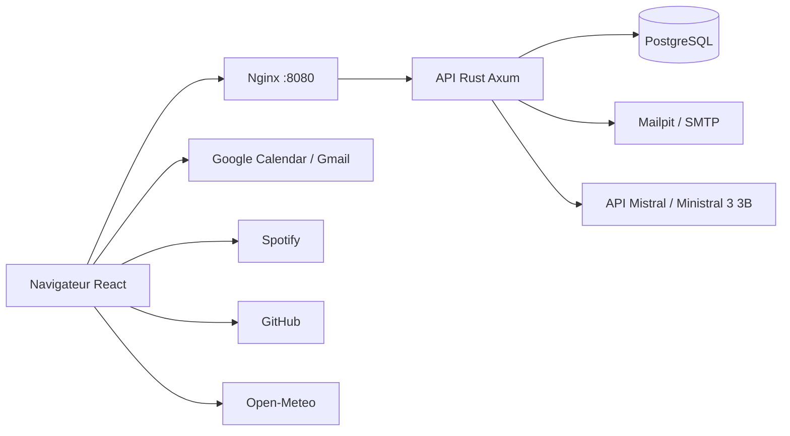

# Lumi

Projet de tableau de bord réalisé dans le cadre du module G-WEB-500.

## Présentation

L'application propose des dashboards personnalisables, sauvegardés dans le compte utilisateur, avec cinq intégrations externes (GitHub, Spotify, Gmail, Google Calendar et Open-Meteo), un assistant IA Mistral et trois outils locaux.

Lumi rassemble des notes, un minuteur de concentration et des widgets dans un tableau de bord personnalisable. L’interface React communique avec une API Rust pour les comptes et les sessions.

Le sujet du projet est disponible dans [dashboard-project.pdf](docs/dashboard-project.pdf).

La liste des tâches et des priorités est disponible dans [TODO.md](docs/TODO.md). Le [contrôle du 9 octobre 2026](docs/VERIFICATION_2026-10-09.md) détaille les résultats actuels et les réserves de conformité.

Les règles visuelles et les composants de référence sont décrits dans [DESIGN_SYSTEM.md](docs/DESIGN_SYSTEM.md).

## Technologies utilisées

- Frontend : React en JavaScript (JSX), avec Vite.
- Backend : Rust avec le framework Axum.
- Base de données : PostgreSQL, requêtes et migrations SQLx (sans Prisma).

## Prérequis

Node.js 20.19 ou supérieur, npm, Rust avec Cargo et PostgreSQL 16 (ou Docker Compose pour la base locale).

## Organisation

- `frontend/` : interface React et configuration Vite.
- `backend/` : API Rust avec Axum, documentation OpenAPI et tests.
- `package.json` : commandes communes et workspaces npm.

## Installation

1. Cloner le dépôt et ouvrir le dossier du projet.
2. Installer toutes les dépendances depuis la racine :

```bash
npm install
```

## Configuration

Copier la configuration locale puis démarrer PostgreSQL et la boîte mail locale :

```bash
cp .env.example .env
npm run services
```

`DATABASE_URL` est obligatoire. Le backend charge `.env` et applique les migrations SQLx au démarrage. Le volume Docker conserve les données entre les redémarrages.

En développement, `LUMI_SEED_DEMO=true` crée le compte `demo@lumi.local` / `lumi-demo` s'il n'existe pas. Les variables `LUMI_DEMO_EMAIL` et `LUMI_DEMO_PASSWORD_HASH` permettent de personnaliser le compte lors de sa création. Désactiver ce bootstrap hors développement. Les comptes et sessions sont désormais stockés dans PostgreSQL.

Le backend écoute sur `127.0.0.1:3001` et le frontend sur `localhost:5174`. Vite transmet `/api` au backend via son proxy.

Le périmètre actuel couvre la création de compte et la connexion avec les rôles `perso`, `employe`, `entreprise` et `admin`. Les rôles sont cumulables et contrôlés côté serveur. L'inscription publique ne permet pas de s'attribuer le rôle administrateur.

Le formulaire de connexion demande uniquement l’e-mail et le mot de passe. Le profil se choisit à l’inscription ; le rôle de connexion est déterminé par le serveur. Le tableau de bord propose des widgets personnalisables, sauvegardés dans PostgreSQL par compte. Les anciens widgets locaux sont importés lors de la création du premier dashboard serveur.

Les quatre comptes de test (un par rôle), leurs identifiants et la commande `npm run seed:test` sont documentés dans [Comptes de test](docs/COMPTES.md).

Voir le [contrat API des comptes](docs/api/accounts.md) pour le modèle relationnel, les exemples de requêtes et la migration depuis la première version.

## Lancement

`npm run dev` démarre automatiquement PostgreSQL et Mailpit via Docker Compose, attend leur disponibilité, puis lance le backend et Vite. Docker doit être démarré. Pour l’assistant IA, renseigner `MISTRAL_API_KEY` dans `.env` (voir ci-dessous). Aucun modèle n’est téléchargé.

### Développement

Depuis la racine :

```bash
npm run dev
```

Ouvrir http://localhost:5174 puis créer un compte ou se connecter. Vite actualise le frontend lors des modifications ; pour une modification Rust, arrêter puis relancer `npm run dev`. Utiliser `Ctrl+C` pour arrêter les deux serveurs.

L’API est aussi accessible directement : http://127.0.0.1:3001/api/health.

### Confirmation et connexion par e-mail

Les nouveaux comptes doivent confirmer leur adresse avant de se connecter. Les comptes de démonstration initialisés par `LUMI_SEED_DEMO=true` ou `npm run seed:test` sont déjà validés et restent accessibles sans e-mail.

En local, lancer `npm run services` avant `npm run dev`. Les e-mails sont consultables dans **http://localhost:8025** (Mailpit) : ils ne sont pas transmis à une boîte externe. Ouvrir le lien reçu puis confirmer l’action. Le renvoi est limité à une demande par minute et cinq par heure, tous types de liens confondus.

Pour recevoir les messages dans une vraie boîte, renseigner dans `.env` les paramètres fournis par le prestataire : `SMTP_HOST`, `SMTP_PORT`, `SMTP_SECURITY=starttls` (port 587) ou `tls` (port 465), `SMTP_USERNAME`, `SMTP_PASSWORD`, ainsi qu’un `MAIL_FROM` autorisé. `APP_URL` doit désigner l’adresse du frontend accessible au destinataire (HTTPS hors localhost). Redémarrer le backend après modification.

Le lien de connexion remplace le mot de passe ; ce parcours n’est pas une seconde étape après le mot de passe (A2F). Les liens de confirmation, connexion et réinitialisation expirent respectivement après 24 heures, 15 minutes et 30 minutes et ne sont utilisables qu’une fois.

### Widgets Google Calendar

Deux widgets permettent de consulter les échéances du mois et le planning semaine/jour, puis de créer des événements avec priorité, labels techniques et échéance. Ils utilisent l’agenda Google principal du compte connecté. Configurer `VITE_GOOGLE_CLIENT_ID` dans `.env` puis redémarrer le frontend : voir le [guide Google Calendar](docs/integrations/google-calendar.md).

Pour connecter un agenda en tant qu'utilisateur :

1. Se connecter à Lumi.
2. Cliquer sur **Ajouter un widget**, puis choisir un widget **Agenda**.
3. Cliquer sur **Connecter Google Calendar**.
4. Choisir le compte Google à utiliser dans la fenêtre Google et accepter l'accès aux événements.

La connexion est valable pour la session de la page. Elle n'enregistre ni mot de passe Google ni secret dans Lumi. Si le bouton n'est pas disponible, l'application doit d'abord être configurée par la personne qui la déploie, comme indiqué dans le [guide complet Google Calendar](docs/integrations/google-calendar.md).

### Documentation interactive — Swagger UI

Avec `npm run dev` lancé, ouvrir http://localhost:5174/api/docs (ou directement http://127.0.0.1:3001/api/docs).

Déplier **GET /api/health**, cliquer sur **Try it out**, puis **Execute** pour envoyer une requête et afficher la réponse du backend.

La spécification OpenAPI est disponible sur `/api/openapi.json`. Elle est définie à partir des annotations Rust dans `backend/src/lib.rs`, `auth.rs`. Les routes privées sont testables avec le bouton **Authorize** et le jeton reçu à la connexion. Les fichiers Swagger UI sont servis localement par le backend, sans CDN.

### Compilation et production

```bash
npm run build
npm start
```

`npm start` lance uniquement le backend compilé. Pour déployer le frontend, servir les fichiers de `frontend/dist/` avec un serveur web et configurer ce serveur pour transmettre `/api` au backend. Le lancement Docker complet est décrit ci-dessous.

## Tests

```bash
npm test
```

Les tests backend utilisent `DATABASE_URL` et une base PostgreSQL isolée par scénario ; le compte de test doit pouvoir créer des bases. Ils vérifient l’inscription, les rôles cumulables, le contrôle du rôle de connexion, les sessions et l’unicité des comptes. Voir les [instructions détaillées](docs/api/accounts.md#vérifications).

## Équipe

- Milo Bousquet — conception, frontend, backend, intégrations, tests et documentation.
- Nathan Muzay — conception, frontend, backend, intégrations, tests et documentation.

## Licence

La licence reste à définir. Voir [LICENCE.md](LICENCE.md).

## Lancement complet avec Docker

Depuis un clone, copier `.env.example` vers `.env`, puis lancer :

```bash
docker compose build
docker compose up -d --wait
```

Ouvrir **http://localhost:8080**. Nginx sert React et transmet `/api` et `/about.json` au backend Rust ; PostgreSQL et Mailpit démarrent avec l’application. Les migrations sont appliquées automatiquement. Les e-mails locaux restent consultables sur http://localhost:8025. `docker-compose build` et `docker-compose up` conviennent également si le binaire Compose historique est installé.

Le fichier racine est `docker-compose.yml`. `npm run services` démarre PostgreSQL et Mailpit pour le développement. `docker compose down` arrête la stack sans effacer les données ; ne pas ajouter `-v` si les comptes doivent être conservés.

`DOCKER_APP_URL` permet de changer l’origine utilisée dans les liens e-mail Docker (défaut `http://localhost:8080`). Cette stack utilise Mailpit ; pour un déploiement public, configurer un serveur SMTP réel et HTTPS. Les identifiants OAuth `VITE_GOOGLE_CLIENT_ID` et `VITE_SPOTIFY_CLIENT_ID` sont injectés à la compilation : reconstruire l’image frontend après modification et autoriser l’origine/URL de retour correspondante chez le fournisseur.

Le backend Docker n’expose pas son port à l’hôte. `TRUST_PROXY=true` lui permet de lire l’IP fournie par Nginx, qui remplace l’en-tête client ; ne pas activer cette option pour un backend directement accessible.

## Services et widgets

Tous les widgets possèdent un titre et une taille configurables.

| Service | Widget | Paramètres spécifiques | État |
| --- | --- | --- | --- |
| GitHub | Push récents | Dépôt, 1–20 événements, intervalle 300–3600 s | Dépôts publics ou jeton personnel, cache mémoire 30 s |
| GitHub | Graphe des commits | Dépôt, intervalle 300–3600 s | Branches et commits, historique des observations en session |
| Mistral | Assistant IA | Titre et taille | Demande explicite, Ministral 3 3B, clé côté serveur |
| Spotify | Lecture en cours | Client ID, rafraîchissement 5–120 s | OAuth PKCE, validation avec compte réel restante |
| Spotify | Top titres | Client ID, période, 1–10 titres, intervalle 30–3600 s | Actualisation périodique |
| Gmail | Non lus | Client ID, 1–20 messages, intervalle 30–3600 s | OAuth, lecture et actions explicites |
| Gmail | Rédiger | Client ID, compte indicatif | Envoi explicite depuis Lumi |
| Google Calendar | Échéances du mois | Titre, intervalle 30–3600 s | Agenda principal connecté |
| Google Calendar | Planning semaine/jour | Titre, intervalle 30–3600 s | Agenda principal connecté |
| Local | Habitudes | Noms des habitudes, titre, taille | Grille hebdomadaire, cases quotidiennes, séries et historique persistant |
| Local | Notes | Contenu | Sauvegardé dans le compte avec le dashboard |
| Local | Focus | Durée 5–120 minutes | Minuteur local |
| Open-Meteo | Météo | Ville, intervalle | Conditions actuelles, sans compte fournisseur ; [guide](docs/integrations/weather.md) |

Voir les guides [Calendar](docs/integrations/google-calendar.md) , [Gmail](docs/integrations/gmail.md) et [GitHub](docs/integrations/github.md). Les autorisations externes nécessitent une configuration fournisseur ; leur présence dans le catalogue ne prouve pas une validation de bout en bout. Le catalogue machine est disponible publiquement sur `/about.json`, avec l’IP du client, l’heure Unix et les paramètres de type `integer` ou `string`. Le groupe `local` y identifie Notes, Focus et Habitudes ; le service `weather` identifie les conditions Open-Meteo.

## Architecture

L’organisation des sources et les responsabilités des modules sont décrites dans [docs/ARCHITECTURE.md](docs/ARCHITECTURE.md).



Les comptes, sessions, dashboards et abonnements sont conservés en PostgreSQL. Chaque opération de dashboard vérifie le propriétaire depuis la session. Les versions de sauvegarde détectent les modifications concurrentes et demandent de recharger en cas de conflit. Les intégrations externes sont appelées depuis le navigateur ; les jetons Google restent en mémoire, et les jetons Spotify/GitHub sont conservés uniquement en mémoire, liés à la session Lumi. Les routes privées utilisent la session et les permissions vérifiées par le serveur.

## Sécurité des connexions externes

Les jetons Spotify et GitHub ne sont plus persistés dans `localStorage` ou `sessionStorage`. Les anciens jetons stockés sont supprimés lors de l’accès au module de session. Ils sont effacés à la déconnexion et deviennent inaccessibles lorsque la session Lumi change. Une reconnexion au fournisseur est nécessaire après rechargement. Le matériel temporaire PKCE Spotify reste dans `sessionStorage` le temps du retour OAuth, lié à la session Lumi initiatrice ; une réponse tardive d’une ancienne session est refusée.

Pour Spotify en local, ouvrir Lumi sur `http://127.0.0.1:8080` (ou `:5174` en développement) et s’y connecter avant d’autoriser Spotify, afin de garder la même origine au retour OAuth. Les requêtes Spotify authentifiées sont limitées à `https://api.spotify.com/v1/` et refusent les redirections.

Nginx et l’API ajoutent les en-têtes `X-Content-Type-Options`, `X-Frame-Options` et `Referrer-Policy`. L’API interdit la mise en cache. Les dashboards sont stockés côté serveur. Nginx applique une CSP qui restreint les scripts et connexions aux fournisseurs utilisés. La connexion par mot de passe est limitée à dix tentatives par adresse sur quinze minutes. Les journaux JSON contiennent la route générique, le statut, la durée et un identifiant de requête, sans corps, e-mail ni jeton. HTTPS et un filtrage réseau doivent être configurés pour un déploiement public. La CSP ne dispense pas d’une revue de sécurité des évolutions. Les anciennes sauvegardes locales restent disponibles pour récupération manuelle.

## Utiliser les nouvelles fonctions

1. Dans **Mon compte → Mes services**, activer les services souhaités. Cette préférence ouvre leur catalogue ; la connexion au fournisseur se fait depuis les widgets. La désactivation conserve les widgets existants et ne révoque pas le consentement chez le fournisseur.
2. Dans **Nouveau dashboard**, créer un espace (20 maximum). Ajouter, modifier et organiser les widgets (100 maximum par dashboard). La sauvegarde automatique se déclenche après une courte pause. Attendre « Enregistré dans votre compte » avant de fermer la page.
3. Utiliser le sélecteur pour changer d’espace, ou **Exporter / Importer** pour transférer une configuration JSON. Les exports ne contiennent pas les jetons externes. L’import crée un espace séparé.
4. En cas de conflit entre appareils, exporter les modifications locales puis **Recharger la version serveur**. Aucun écrasement silencieux n’est effectué. Le rechargement récupère les sauvegardes des autres appareils ; il n’y a pas de synchronisation collaborative instantanée.
5. **Organiser** permet le glisser-déposer et le redimensionnement sur ordinateur. **Monter / Descendre** fonctionne au clavier et au toucher, et réordonne les widgets en une colonne. Le formulaire conserve les réglages fins de grille.
6. Le centre de notifications garde les vingt derniers messages de la session, notamment la fin d’un minuteur Focus. Les widgets GitHub gardent jusqu’à 24 observations du nombre d’éléments chargés ; ce n’est pas un historique exhaustif de l’activité du dépôt.

Un compte connecté avec le rôle `admin` dispose dans **Mon compte** de la liste des utilisateurs, de la recherche, de la modification des rôles et de la révocation des sessions. Un administrateur ne peut pas modifier ses propres rôles ni révoquer sa propre session par cet écran. Le rôle administrateur reste attribué hors inscription publique.

## Connexion à Lumi avec Google

Renseigner `GOOGLE_OIDC_CLIENT_ID` côté backend avec le client Web autorisé chez Google, puis redémarrer le backend (ou reconstruire/redémarrer Docker). Ajouter l’origine utilisée aux origines JavaScript autorisées chez Google. Cette connexion est distincte de l’autorisation Gmail/Calendar.

Dans la fenêtre de connexion, **Connexion avec Google** initialise le bouton officiel Google. Un compte existant portant la même adresse doit d’abord se connecter normalement, puis choisir **Associer mon compte Google** dans Mon compte. Les comptes nouveaux reçoivent uniquement le rôle `perso`. Aucun compte existant n’est associé automatiquement par simple égalité d’e-mail.

Le serveur vérifie la signature RSA avec les clés Google, l’émetteur, l’audience, l’expiration, l’adresse confirmée et un nonce à usage unique valable dix minutes. Les clés publiques sont mises en cache cinq minutes. Documentation : [validation des jetons Google](https://developers.google.com/identity/gsi/web/guides/verify-google-id-token) et [OpenID Connect](https://developers.google.com/identity/openid-connect/openid-connect). Une configuration et une connexion réelles restent nécessaires pour valider le parcours fournisseur.

## Tests navigateur reproductibles

Après `npm install` et le démarrage des services locaux :

```bash
npx playwright install chromium
docker compose exec postgres createdb -U lumi lumi_e2e
npm run test:e2e -w frontend
```

Créer la base une seule fois. `frontend/playwright.config.js` lance des serveurs dédiés sur les ports 3001 et 5174 : arrêter les serveurs de développement avant les tests. La base `lumi_e2e` reste distincte de `lumi`. Les parcours vérifient l’édition, le rechargement, l’import/export, les instances, les abonnements, les conflits, une panne GitHub et le viewport mobile. La démonstration vidéo est exclue par défaut et s’exécute avec `DEMO_RECORD=1 npm run test:e2e -w frontend -- --grep @demo`.

Les tests de services unitaires utilisent des réponses simulées. Ils ne remplacent pas les essais OAuth réels ni un audit de sécurité. Voir [la recette fournisseur](docs/RECETTE.md), [le script de soutenance](docs/PRESENTATION.md) et [le périmètre des bonus](BONUS.md).

La connexion Spotify s’ouvre dans une fenêtre dédiée : le dashboard reste ouvert et conserve les connexions Gmail, Calendar et GitHub en mémoire. Autoriser les fenêtres contextuelles pour Lumi. Un rechargement manuel de la page efface toujours les jetons externes.

## Assistant IA Mistral

Le widget appelle **Ministral 3 3B** (`ministral-3b-2512`) via le backend. C’est le modèle de conversation le moins cher du [tarif Mistral consulté le 19 octobre 2026](https://docs.mistral.ai/inference/pricing) : 0,10 $ par million de tokens en entrée et 0,10 $ en sortie. Le mode Free de Studio permet également des essais sous quotas.

Créer une clé dans [Mistral Studio](https://console.mistral.ai), rubrique **API Keys → Create new key**, puis compléter le fichier `.env` existant :

```dotenv
MISTRAL_API_KEY=votre_cle_privee
MISTRAL_MODEL=ministral-3b-2512
```

La clé reste côté serveur ; ne pas la placer dans une variable `VITE_` ni la committer. Redémarrer `npm run dev`, ou reconstruire et relancer la stack avec `docker compose up -d --build --wait --remove-orphans`. Cette dernière commande retire les anciens conteneurs Ollama sans effacer leur volume. Le projet démarre sans clé, mais l’assistant indique qu’il doit être configuré.

Activer **Assistant IA Mistral** dans **Mon compte → Mes services**, puis ajouter le widget. Les identifiants historiques `openai_chat` et `openai` restent compatibles. Les questions sont envoyées à Mistral au clic sur Envoyer ; Lumi ne stocke pas les échanges en base. Chaque demande est indépendante et ne consulte ni les autres widgets ni les données en direct.

Les expressions arithmétiques explicites sont calculées en Rust sans appel API ; les calculs en langage naturel sont traduits par Mistral, vérifiés puis calculés en Rust. Limites : 8 000 caractères, cinq demandes par minute par utilisateur, une génération simultanée et 384 tokens de réponse (256 pour interpréter un calcul), sans réessai automatique payant. Voir [le guide Mistral](docs/ASSISTANT_MISTRAL.md).

## Corrections après soutenance

Le [bilan des modifications](docs/REMEDIATION_SOUTENANCE.md) relie les corrections à chaque critère du jury : météo réelle, responsive, accessibilité, contrat public et protection du serveur. Les [comparaisons Front/Back/BDD](docs/CHOIX_TECHNOLOGIQUES.md) présentent trois solutions par couche sur les mêmes critères, avec limites et alternatives.

Le POC se lance avec `npm run services` puis `npm run poc` ; voir [son protocole](poc/README.md). Les [résultats de vérification](docs/VALIDATION_REMEDIATION.md) distinguent les tests automatisés et les essais fournisseurs.

**Accessibilité** ouvre les réglages de texte agrandi et de contraste. **Mon compte → Vos données** précise le stockage PostgreSQL, les préférences locales et les transferts vers les fournisseurs. Nginx limite les API par IP et les corps JSON à 1 Mio ; ces protections complètent les contrôles existants et concernent l’accès via le proxy Docker.


### Configuration du serveur

Une valeur `.env` contenant des espaces doit être entre guillemets, par exemple `MAIL_FROM="Lumi <noreply@lumi.local>"`. Le serveur refuse de démarrer avec un `.env` mal formé, sans divulguer ses valeurs. Redémarrer après modification. Pour Mailpit (`SMTP_SECURITY=local`), laisser `SMTP_USERNAME` et `SMTP_PASSWORD` vides ou commentés.

### Envoyer les confirmations avec Gmail (développement)

Activer la validation en deux étapes du compte expéditeur puis créer un [mot de passe d’application Google](https://myaccount.google.com/apppasswords) nommé Lumi. Voir les [conditions Google](https://support.google.com/mail/answer/185833?hl=fr) si cette option n’est pas disponible. Le mot de passe habituel du compte Google ne convient pas.

Dans `.env` à la racine, remplacer les paramètres Mailpit :

```dotenv
SMTP_HOST=smtp.gmail.com
SMTP_PORT=587
SMTP_SECURITY=starttls
SMTP_USERNAME=votre.adresse@gmail.com
SMTP_PASSWORD=mot_de_passe_application_sans_espaces
MAIL_FROM="Lumi <votre.adresse@gmail.com>"
APP_URL=http://127.0.0.1:5174
```

`SMTP_USERNAME` et `MAIL_FROM` doivent utiliser votre adresse expéditrice. Garder le mot de passe d’application dans `.env`, jamais dans Git ou dans une variable `VITE_*`. Les [paramètres SMTP Google](https://support.google.com/mail/answer/7104828?hl=fr) utilisent STARTTLS sur le port 587.

Arrêter le processus `npm run dev` existant avec Ctrl+C, puis le relancer pour recharger `.env`. Créer un nouveau compte Lumi avec une adresse réelle ou demander le renvoi de confirmation (une minute minimum entre deux demandes). Les comptes de test initialisés sont déjà confirmés. Les anciens messages Mailpit ne sont pas réexpédiés.

Les liens utilisant `127.0.0.1` doivent être ouverts sur l’ordinateur où Lumi tourne. Pour des destinataires sur d’autres appareils, configurer une origine HTTPS accessible. La stack Docker conserve sa configuration Mailpit propre : cette procédure concerne `npm run dev`.


## Habitudes et connexion persistante

Dans **Ajouter un widget**, choisir **Habitudes · Suivi quotidien**. Définir jusqu’à 20 habitudes, puis cocher les jours accomplis dans la grille hebdomadaire. Les flèches permettent de consulter les semaines précédentes ; les jours futurs sont désactivés. Le widget affiche la progression sur les jours écoulés et la série actuelle de chaque habitude. Modifier un nom conserve son historique ; retirer une ligne puis enregistrer supprime cet historique. Les données sont sauvegardées avec le dashboard dans PostgreSQL et conservées dans les exports JSON.

La connexion à **Lumi** est maintenant conservée pendant **sept jours à partir de la connexion**, même après fermeture du navigateur ou redémarrage du serveur. Le cookie de session est `HttpOnly`, `SameSite=Lax`, et `Secure` lorsque `APP_URL` utilise HTTPS. Le bouton **Se déconnecter** révoque la session et efface le cookie. Les sessions existantes en mémoire d’onglet sont migrées lors de leur restauration, sans prolonger leur expiration.

Utiliser la même adresse à chaque ouverture : `localhost` et `127.0.0.1` ne partagent pas leurs cookies. Conserver le volume PostgreSQL et les cookies du navigateur. Cette persistance concerne Lumi ; les connexions aux fournisseurs Google, Spotify et GitHub gardent leur fonctionnement temporaire actuel.

Validation actualisée le 11 octobre : 48 tests frontend, 39 tests Rust et 18 parcours navigateur réussis ; scénario vidéo ignoré par défaut. Le parcours navigateur vérifie les habitudes après rechargement et renommage, ainsi qu’une réouverture avec uniquement les cookies, sans restauration de `sessionStorage` ou `localStorage`. Les tests Rust vérifient la même session avec une nouvelle instance du serveur, son expiration, sa révocation et le rejet des mutations par cookie sans l’en-tête client attendu.

### Conformité après soutenance

Les nouvelles instances et imports de services nécessitent une activation côté serveur. Désactiver un service conserve ses widgets en pause. Les bonus autonomes sont regroupés dans `bonus/` ; voir [le périmètre](BONUS.md), [le bilan](docs/REMEDIATION_SOUTENANCE.md) et [les preuves du 11 octobre](docs/VERIFICATION_2026-10-11.md).

Les sommes d’intervalles entiers avec exclusions sont aussi calculées en Rust après interprétation par Mistral : « somme des nombres de 1 à 12 en excluant 11 » donne **67**. Le plan est vérifié pour conserver les nombres de la demande ; les intervalles sont bornés à 10 000 entiers et 100 exclusions distinctes.
